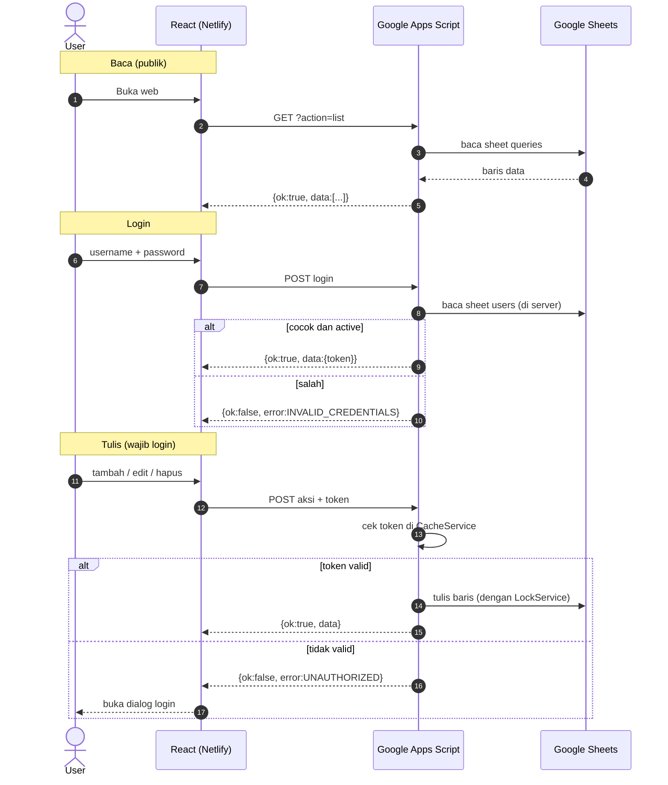

# PRD: Herbarium (Pustaka Query Superset)

Simpan sebagai `docs/PRD.md`. Dokumen ini adalah sumber kebenaran fungsional. Untuk tampilan, lihat `docs/DESIGN-PRD.md`.

## 1. Ringkasan
Herbarium adalah web internal untuk menyimpan, mencari, dan menyalin query Superset milik tim.
Siapa pun yang punya link web bisa **melihat dan menyalin**. Untuk **menambah, mengedit, dan menghapus**, pengguna harus **login** dengan akun yang tercatat di Google Sheets.

| Lapisan | Teknologi |
|---|---|
| Frontend | React + Vite, deploy ke Netlify |
| Backend / API | Google Apps Script (GAS) Web App |
| Database | Google Sheets (sheet `queries` dan `users`) |
| Biaya | Rp0 (free tier) |

Sumber data awal: `KODE & QUERY ANNISA.md`.

## 2. Masalah
- Query tersimpan di satu file markdown panjang (~88 KB), sulit dicari dan dibagikan.
- Rekan tim butuh menyalin query dengan cepat tanpa menyeleksi teks manual.
- Perubahan harus bisa dilakukan tim tanpa mengedit file mentah, dan hanya oleh orang yang berhak.

## 3. Tujuan
- G1: Menemukan query dalam < 3 detik (pencarian + filter).
- G2: Menyalin SQL dengan 1 klik.
- G3: Tambah/edit/hapus query lewat form sederhana (4 isian).
- G4: Hanya pengguna login yang bisa mengubah data.
- G5: Biaya operasional Rp0.

## 4. Non-Goals
- Tidak mengeksekusi SQL dan tidak terhubung ke database rumah sakit atau API Superset.
- Tidak ada halaman daftar mandiri (akun dibuat admin langsung di sheet).
- Tidak ada role (semua akun yang login setara).
- Tidak ada deskripsi, tag, atau tautan Superset per query.
- Tidak menyimpan data pasien. Hanya logika query.

## 5. Pengguna
| Persona | Kebutuhan | Akses |
|---|---|---|
| Viewer (rekan tim) | Cari, baca, salin query | Bebas, tanpa login |
| Editor (Annisa dan akun lain) | Tambah, edit, hapus query | Wajib login |
| Admin (pemilik Sheet) | Mengelola akun | Edit langsung sheet `users` |

### User Stories
| ID | Sebagai | Saya ingin | Agar |
|---|---|---|---|
| US-01 | Viewer | Mencari query lewat judul, kategori, atau isi SQL | Menemukan query < 3 detik |
| US-02 | Viewer | Memfilter berdasarkan kategori dan jenis | Fokus pada satu domain analitik |
| US-03 | Viewer | Menyalin SQL dengan 1 klik dan melihat toast | Langsung paste ke Superset SQL Lab |
| US-04 | Editor | Login dengan username dan password | Mendapat izin mengubah data |
| US-05 | Editor | Menambah query lewat form 4 isian | Koleksi tetap mutakhir |
| US-06 | Editor | Mengedit dan menghapus query | Menjaga isi tetap benar |
| US-07 | Admin | Menambah atau menonaktifkan akun lewat sheet | Mengontrol siapa yang boleh mengedit |

## 6. Skema Data (Google Sheets)

### 6.1 Sheet `queries`
| Kolom | Tipe | Aturan |
|---|---|---|
| `id` | string | `qry_` + unik (timestamp base36 + acak), dibuat server |
| `title` | string | wajib, maks 150 karakter |
| `category` | string | wajib (Rawat Inap, Rawat Jalan, Farmasi, IGD, Dataset, dll.; bisa tambah baru) |
| `type` | string | wajib, hanya `Query` atau `Dashboard` |
| `sql_query` | string | wajib, disimpan sebagai teks biasa |
| `created_at` | ISO 8601 | diisi server |
| `updated_at` | ISO 8601 | diisi server |
| `updated_by` | string | username pengedit terakhir, diisi server |

Form input hanya 4 isian: **Judul, Kategori, Jenis, Query SQL**. Kolom lain otomatis.

`type` berarti label pembeda: `Query` untuk query SQL Lab biasa, `Dashboard` untuk query yang dipakai sebagai dataset/chart dashboard.

### 6.2 Sheet `users`
| Kolom | Aturan |
|---|---|
| `username` | unik, huruf kecil |
| `password` | teks biasa (keputusan MVP, lihat risiko R2) |
| `active` | `TRUE` / `FALSE`; `FALSE` = tidak bisa login |

Menambah akun: admin mengisi baris baru. Menonaktifkan akun: ubah `active` menjadi `FALSE`.

## 7. Kebutuhan Fungsional

### FR-1 Daftar dan Detail
- Tampilkan kartu: judul, badge kategori, badge jenis, cuplikan SQL 3 baris, tombol salin.
- Detail: SQL lengkap dengan syntax highlighting, metadata (`updated_at`, `updated_by`).

### FR-2 Pencarian dan Filter
- Ctrl/Cmd+K membuka command palette. Pencarian fuzzy di judul, kategori, dan isi SQL.
- Filter kategori (satu pilihan) dan jenis (Semua / Query / Dashboard). Kombinasi bersifat AND.
- State filter tersimpan di URL query string.

### FR-3 Salin
- Tombol Salin menyalin `sql_query` apa adanya.
- Toast "Tersalin" muncul; ada fallback jika Clipboard API gagal.

### FR-4 Login
- Tombol **Masuk** di header membuka dialog dengan 2 isian: username dan password.
- Login berhasil: header menampilkan username, tombol Tambah/Edit/Hapus dan tombol **Keluar** muncul.
- Aksi tulis tanpa sesi valid membuka dialog login lalu melanjutkan aksi setelah berhasil.
- Sesi berlaku 6 jam, lalu login ulang.

### FR-5 CRUD (wajib login)
- Tambah, edit, hapus lewat modal; hapus butuh konfirmasi.
- Dropdown kategori memuat kategori yang sudah ada plus opsi "Tambah kategori baru".
- Validasi di klien dan server.

### FR-6 Tema
- Dark/light mode, default mengikuti sistem, pilihan disimpan di localStorage.

### FR-7 State UI
- Loading skeleton, empty state, error state dengan tombol coba lagi.

## 8. Kebutuhan Non-Fungsional
- **Performa:** muat awal < 3 detik untuk ≤ 500 query; data di-cache di klien (stale-while-revalidate).
- **Keamanan:**
  - Pencocokan username/password dilakukan **di GAS**, bukan di React. Isi sheet `users` tidak pernah dikirim ke browser.
  - Endpoint `list` hanya membaca sheet `queries`, tidak pernah menyentuh `users`.
  - Token sesi disimpan di `CacheService` GAS; di browser disimpan di `sessionStorage`.
  - SQL dirender sebagai teks. Tidak ada `dangerouslySetInnerHTML` tanpa sanitasi.
  - Kolom `sql_query` diformat teks biasa di GAS agar isi berawalan `=`, `+`, `-`, `@` tidak dibaca sebagai formula.
- **Konkurensi:** operasi tulis memakai `LockService`.
- **Anti brute force:** 5 login gagal per username mengunci login 15 menit (`CacheService`).
- **Aksesibilitas:** navigasi keyboard, kontras memadai, `aria-label` pada tombol ikon.
- **Responsif:** desktop dan mobile.

## 9. Kontrak API (GAS Web App)
Deploy: *Execute as: Me*, *Who has access: Anyone*.
Semua respons berstatus HTTP 200 (batasan GAS). Hasil dibaca dari body:
`{ ok: boolean, data?: any, error?: { code, message } }`

| Aksi | Method | Request | Respons `data` |
|---|---|---|---|
| list | GET `?action=list` | - | `Query[]` |
| login | POST | `{action:"login", username, password}` | `{token, username, expiresAt}` |
| logout | POST | `{action:"logout", token}` | `{}` |
| create | POST | `{action:"create", token, payload}` | `Query` |
| update | POST | `{action:"update", token, id, payload}` | `Query` |
| delete | POST | `{action:"delete", token, id}` | `{id}` |

`payload` hanya berisi `title`, `category`, `type`, `sql_query`. Nilai `id`, `created_at`, `updated_at`, `updated_by` dari klien diabaikan.

Kode error: `INVALID_CREDENTIALS`, `UNAUTHORIZED`, `RATE_LIMITED`, `VALIDATION_ERROR`, `NOT_FOUND`, `SERVER_ERROR`.

Catatan CORS: POST dikirim dengan `Content-Type: text/plain;charset=utf-8` agar tidak memicu preflight. Body tetap JSON.

### Alur


## 10. Migrasi Data
- Skrip `scripts/parse-queries.mjs` membaca `KODE & QUERY ANNISA.md` dan menghasilkan `data/queries.json` dan `data/queries.csv`.
- Heuristik awal: heading level 1 = kategori, heading level 2 = judul, blok kode SQL = `sql_query`. `type` default `Query`, diubah manual untuk yang berjenis Dashboard.
- **Heuristik ini belum diverifikasi terhadap isi file asli.** Kirim potongan file sebelum M1 dimulai.
- Isi SQL dipertahankan persis (spasi, baris baru, komentar). File sumber tidak diubah.
- Laporan parser: jumlah query, item tanpa judul/kategori, duplikat, blok kode yang tidak terpetakan.
- Impor ke Sheet lewat fungsi `importBatch()` yang **dijalankan manual dari editor Apps Script**, bukan lewat endpoint web.

## 11. Struktur Proyek
```
/
├─ AGENTS.md
├─ docs/PRD.md
├─ docs/DESIGN-PRD.md
├─ scripts/parse-queries.mjs
├─ data/                  # output migrasi (jangan commit data produksi)
├─ apps-script/
│  ├─ Code.gs
│  └─ README.md           # panduan setup
├─ src/
│  ├─ components/ hooks/ lib/ api/ styles/
├─ public/_redirects      # /* /index.html 200
├─ netlify.toml
└─ .env.example           # VITE_GAS_URL
```

## 12. Milestone dan Acceptance Criteria
| # | Milestone | Selesai bila |
|---|---|---|
| M1 | Parser | Semua query di file `.md` terekstrak; laporan tanpa error kritis; JSON/CSV valid |
| M2 | GAS + Sheets | `list`, `login`, `logout`, `create`, `update`, `delete` berfungsi; kredensial salah ditolak; akun `active=FALSE` ditolak; aksi tulis tanpa token ditolak; panduan setup tersedia |
| M3 | Frontend | FR-1 s.d. FR-7 berjalan terhadap data nyata |
| M4 | Deploy | Build sukses di Netlify; refresh di route mana pun tidak 404; env terisi |

## 13. Risiko
| # | Risiko | Mitigasi |
|---|---|---|
| R1 | URL GAS bersifat publik, sehingga siapa pun yang tahu URL bisa memanggil `list` | Terima sebagai batas MVP; jangan simpan data sensitif atau pasien; jangan publikasikan URL |
| R2 | Password di sheet `users` berupa teks biasa, terbaca oleh siapa pun yang bisa membuka Sheet | Sheet **tidak dibagikan** ke siapa pun selain admin; tiap orang memakai password yang tidak dipakai di akun lain; naik ke hash bila jumlah pengguna bertambah |
| R3 | Brute force login | Batas 5 gagal per username, kunci 15 menit; password panjang |
| R4 | Kuota dan latensi GAS | Cache klien, kurangi pemanggilan `list` |
| R5 | Format `.md` tidak konsisten sehingga parser salah | Review manual hasil parser, laporan parser |
| R6 | Script GAS berjalan atas nama pemilik | Batasi kode hanya membaca/menulis dua sheet ini |

## 14. Pertanyaan Terbuka
- Struktur asli `KODE & QUERY ANNISA.md` (perlu contoh).
- Daftar kategori awal yang baku.
- Apakah `type` = Dashboard berarti query dataset dashboard (asumsi saat ini), atau hal lain?
